  

# ⚡ Awesome Virtual Compute & Elastic Processing 🚀

> **Curated list of top SaaS products, enterprise platforms, and open-source GitHub frameworks for Virtual Compute, Elastic Infrastructure, Serverless Processing, and Distributed Cloud Orchestration.**

**Last updated: October 2026**

---

## 📑 Table of Contents
- [📌 Overview & SEO Keywords](#-overview--seo-keywords)
- [📊 Sector Overview & Market Dynamics](#-sector-overview--market-dynamics)
- [🏢 SaaS & Managed Cloud Compute Platforms](#-saas--managed-cloud-compute-platforms)
- [💻 Open-Source GitHub Projects](#-open-source-github-projects)
  - [Distributed Compute & Processing Engines](#1-distributed-compute--processing-engines)
  - [Serverless & FaaS Frameworks](#2-serverless--faas-frameworks)
  - [Container & Workload Orchestrators](#3-container--workload-orchestrators)
  - [Cloud Infrastructure, MicroVMs & Virtualization](#4-cloud-infrastructure-microvms--virtualization)
- [🤝 How to Contribute](#-how-to-contribute)
- [⚖️ Disclaimer](#-disclaimer)

---

## 📌 Overview & SEO Keywords

**Virtual Compute & Elastic Processing** encompasses modern infrastructure technologies that dynamically provision, scale, orchestrate, and de-provision computing capacity (virtual machines, microVMs, serverless containers, GPUs, and TPUs) in real time to match fluctuating workload demands.

**Target Topics & Keywords:**  
`elastic compute`, `virtual machines`, `serverless faas`, `gpu cloud`, `distributed computing`, `cloud infrastructure`, `container orchestration`, `kubernetes`, `microvms`, `autoscaling`, `firecracker`, `iaas`, `batch processing`, `cloud data warehouse`.

---

## 📊 Sector Overview & Market Dynamics

The global cloud virtual compute and elastic processing market is estimated at **$130+ Billion in 2026** (projected to exceed $300 Billion by 2030, representing a CAGR of ~18–22%), heavily propelled by generative AI training, bursty LLM inference, and serverless data transformation.

The sector exhibits **moderate concentration with a bifurcated dynamic**:
- **Commodity & General-Purpose Compute**: Highly concentrated around hyperscalers (AWS, Microsoft Azure, Google Cloud) operating as an oligopoly with deep enterprise ecosystems, sustained reserved instances, and global backbone networks.
- **AI/GPU & Specialized Serverless Compute**: Moderately fragmented and intensely competitive, with emerging high-performance GPU clouds (CoreWeave, RunPod, Lambda) and developer-first serverless compute platforms (Modal, Fly.io, Anyscale) capturing substantial market share through per-second scale-to-zero economics and rapid hardware iteration.

---

## 🏢 SaaS & Managed Cloud Compute Platforms

The table below is sorted by **Company Size / Valuation (Descending)**:

| Platform 🌐 | Company Size / Valuation 📈 | Starting Tier Pricing 💵 | Free Tier Limit / Trial 🎁 | Description & Core Strengths 💡 |
| :--- | :--- | :--- | :--- | :--- |
| **[AWS EC2](https://aws.amazon.com/ec2/)** | **~$2.1T+** (Amazon Market Cap; AWS ARR >$105B) | **$0.0042/hr** (`t4g.nano`, 2 vCPUs, 0.5 GB RAM) | **750 hours/month** of `t2.micro` or `t3.micro` for 12 months on AWS Free Tier | Global hyperscaler standard with 500+ instance families, Nitro hypervisor, spot pricing, and Auto Scaling groups. |
| **[Azure Virtual Machines](https://azure.microsoft.com/en-us/products/virtual-machines)** | **~$3.1T+** (Microsoft Market Cap; Cloud ARR >$130B) | **$0.0052/hr** (`B1ls`, 1 vCPU, 0.5 GB RAM) | **750 hours/month** of `B1s` VMs for 12 months plus **$200 credit** (30-day trial) | Deep enterprise hybrid cloud integration with Azure Arc, extended lifecycle modernization paths, and reserved instances. |
| **[Google Cloud Compute Engine](https://cloud.google.com/compute)** | **~$2.2T+** (Alphabet Market Cap; GCP ARR >$40B) | **$0.0075/hr** (`e2-micro`, 2 vCPUs, 1 GB RAM) | **1 free non-preemptible `e2-micro` VM/month** (US regions) forever plus **$300 credit** (90-day trial) | Live migration, custom machine types, sustained-use discounts, and premier TPU/GPU accelerators. |
| **[Snowflake Compute Layer](https://www.snowflake.com/)** | **~$45B - $55B** (Public NYSE: SNOW; ARR >$3.5B) | **$2.00/credit** (Standard Edition; XS Virtual Warehouse consumes 1 credit/hr) | **30-day free trial with $400 worth** of usage credits | Decoupled compute with Virtual Warehouses (XS–XXL) and Adaptive Compute pooling for query-level autoscaling. |
| **[Databricks Serverless Compute](https://www.databricks.com/)** | **~$43B** (Private Valuation; ARR >$2.6B) | **$0.07/DBU** (Jobs compute tier; Serverless SQL starting at ~$0.22/DBU) | **14-day free trial** with full platform capabilities (cloud infrastructure billed via customer AWS/Azure/GCP account) | Managed serverless compute for Apache Spark notebooks, Delta Lake, workflows, and ANSI SQL procedural scripting. |
| **[CoreWeave](https://www.coreweave.com/)** | **~$23B** (Valuation, 2024–2026; ARR >$2B) | **$0.22/hr** (CPU instances) / **$2.20/hr** (NVIDIA A100 80GB) | **No free tier**; enterprise trial credits available upon sales consultation and verification | AI-native GPU cloud featuring first GA NVIDIA GB200 NVL72 liquid-cooled racks, 400Gb/s InfiniBand, and bare-metal Kubernetes. |
| **[Ray on Anyscale](https://www.anyscale.com/)** | **~$1B** (Private Valuation; raised $250M+) | **$0.0028/core-hr** ($1.00/Anyscale Cloud Unit - ACU) + pass-through cloud instance costs | **$50 free compute credits** upon registration for new accounts | Managed Ray platform powering distributed model training, batch embedding generation, and post-training (SkyRL, veRL). |
| **[Modal](https://modal.com/)** | **~$500M+** (Valuation, Series A/B; raised $41M+) | **$0.000015/core-sec** ($0.054/CPU-hr) / **$1.95/hr** (NVIDIA L40S) / **$3.95/hr** (H100) | **$30/month free tier credits** recurring every month for personal accounts | Serverless Python container platform with scale-to-zero, per-second billing, sub-second cold starts, and zero infra setup. |
| **[Fly.io](https://fly.io/)** | **~$300M+** (Private Valuation; Series C) | **$0.0000008/sec** ($2.19/month continuous for `shared-cpu-1x` 256MB) | **2-hour trial** for newly deployed microVMs; no recurring free plan | Edge-native elastic compute orchestrating Firecracker microVMs across 35+ global regions with Anycast routing. |
| **[RunPod](https://www.runpod.io/)** | **~$150M - $250M** (Series A; raised $20M+) | **$0.20/hr** (Community Cloud GPUs) / **$1.09/hr** (Secure Cloud L40S) | **No free tier**; $5 initial test credits occasionally provided during promotion campaigns | Developer-first GPU cloud offering on-demand and spot pricing, serverless GPU inference endpoints, and persistent network storage. |

---

## 💻 Open-Source GitHub Projects

Curated list of leading open-source compute frameworks and distributed engines, **sorted strictly by GitHub Stars (Descending)**:

### 1. Distributed Compute & Processing Engines

| Repository 📦 | Stars ⭐ | Primary Focus & Capabilities 🛠️ |
| :--- | :--- | :--- |
| **[Apache Spark](https://github.com/apache/spark)** |  | Unified analytics engine for large-scale distributed data processing, streaming, SQL, and machine learning pipelines. |
| **[Ray](https://github.com/ray-project/ray)** |  | Universal distributed compute engine for scaling Python, AI training, and fine-grained hardware scheduling across CPUs/GPUs/TPUs. |
| **[vLLM](https://github.com/vllm-project/vllm)** |  | High-throughput, low-latency distributed LLM serving engine featuring PagedAttention and continuous batching. |
| **[Dask](https://github.com/dask/dask)** |  | Flexible library for parallel and distributed computing in Python, seamlessly scaling NumPy, Pandas, and Scikit-Learn workflows. |

### 2. Serverless & FaaS Frameworks

| Repository 📦 | Stars ⭐ | Primary Focus & Capabilities 🛠️ |
| :--- | :--- | :--- |
| **[OpenFaaS](https://github.com/openfaas/faas)** |  | Cloud-native serverless framework to deploy event-driven functions and microservices with Docker and Kubernetes. |
| **[Fission](https://github.com/fission/fission)** |  | Fast, Kubernetes-native serverless framework with warm container pools achieving ~100ms cold starts across multiple runtimes. |
| **[Knative Serving](https://github.com/knative/serving)** |  | Kubernetes-based platform providing request-driven auto-scaling (including scale-to-zero), traffic routing, and revisions. |
| **[Self-Hosted Serverless](https://github.com/mstgnz/self-hosted-serverless)** |  | Lightweight, self-hostable Go-based FaaS supporting WebAssembly (WASI via wazero) and Go plugins with built-in metrics and rate limits. |

### 3. Container & Workload Orchestrators

| Repository 📦 | Stars ⭐ | Primary Focus & Capabilities 🛠️ |
| :--- | :--- | :--- |
| **[Kubernetes](https://github.com/kubernetes/kubernetes)** |  | Industry standard container orchestration system for automating deployment, elastic scaling, and containerized management. |
| **[Nomad](https://github.com/hashicorp/nomad)** |  | Flexible, lightweight workload orchestrator to deploy and manage containers, non-containerized legacy apps, and batch jobs at scale. |

### 4. Cloud Infrastructure, MicroVMs & Virtualization

| Repository 📦 | Stars ⭐ | Primary Focus & Capabilities 🛠️ |
| :--- | :--- | :--- |
| **[Firecracker](https://github.com/firecracker-microvm/firecracker)** |  | Open-source minimalist Virtual Machine Monitor (VMM) using KVM to create secure, ultra-fast microVMs powering modern serverless. |
| **[KubeVirt](https://github.com/kubevirt/kubevirt)** |  | Kubernetes virtualization add-on enabling declarative management and scheduling of traditional VMs alongside containers. |
| **[OpenStack Nova](https://github.com/openstack/nova)** |  | Cloud computing fabric controller providing on-demand, massively scalable virtual machine and bare-metal provisioning for IaaS. |
| **[Apache CloudStack](https://github.com/apache/cloudstack)** |  | Turnkey open-source IaaS software for deploying and managing high-availability public and private compute clouds. |

---

## 🤝 How to Contribute

Contributions, suggestions, and corrections are welcome! 🚀

1. 🍴 Fork the repository.
2. 🌿 Create a descriptive feature branch (`git checkout -b feature/add-compute-engine`).
3. 📝 Update `README.md` following the exact tabular format:
   - For **SaaS**: include verified pricing, specific free tier limits, and verifiable valuation/revenue.
   - For **Open-Source**: include GitHub star badge linking to the `/stargazers` page, and maintain sorting order.
4. 🚀 Push changes and open a pull request!

---

## ⚖️ Disclaimer

- This repository is a **community-curated index** and does not constitute commercial endorsement or financial advice.
- Cloud compute instances and high-performance GPU resources incur real-time costs. Always verify provider billing schedules, configure strict spending quotas, and implement auto-shutdown policies.
- Project stars, market valuations, and pricing tiers reflect verified estimates and vendor schedules as of October 2026.

---

  Built with ❤️ for platform architects, cloud engineers, DevOps practitioners, and distributed systems builders.

